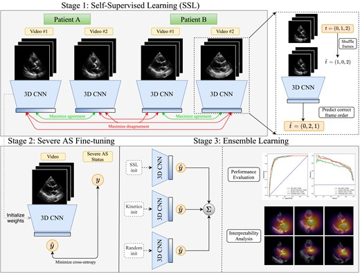
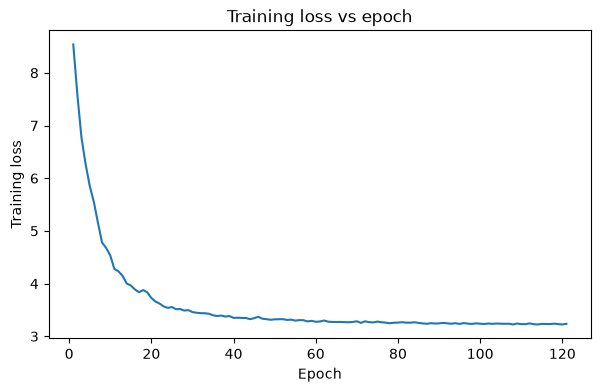
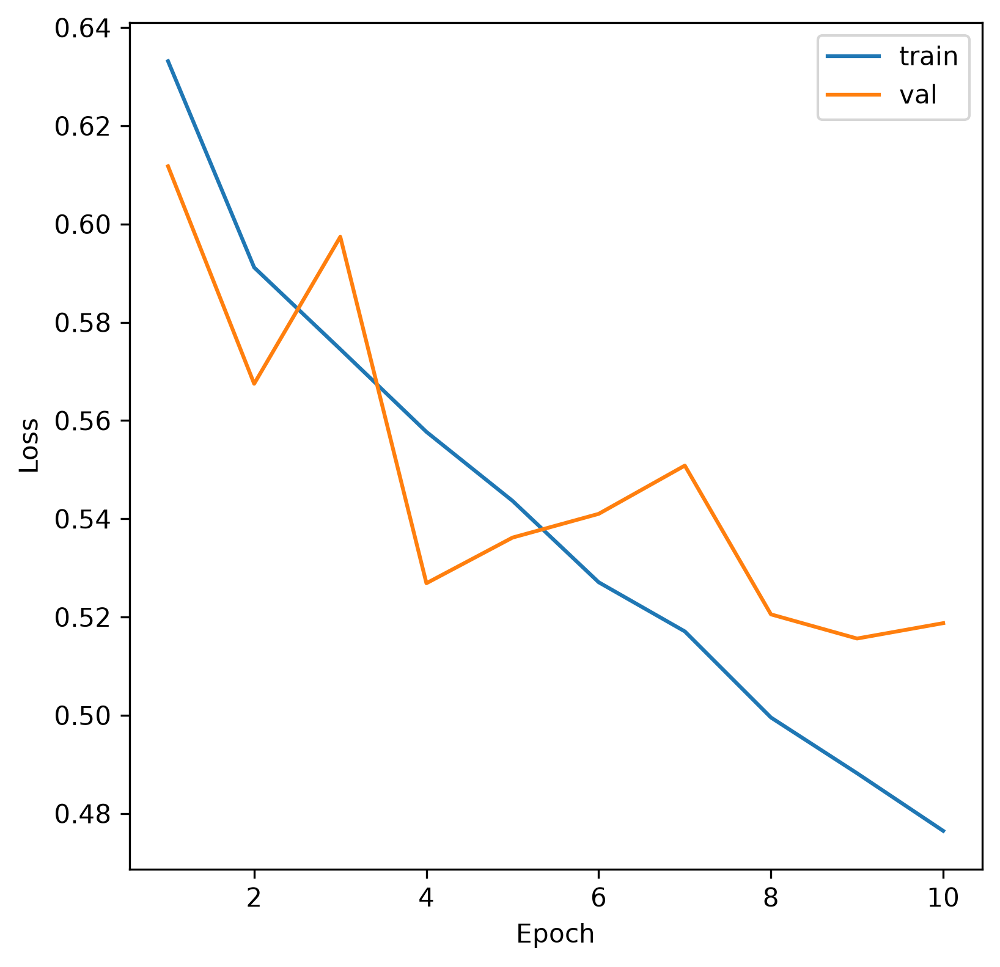
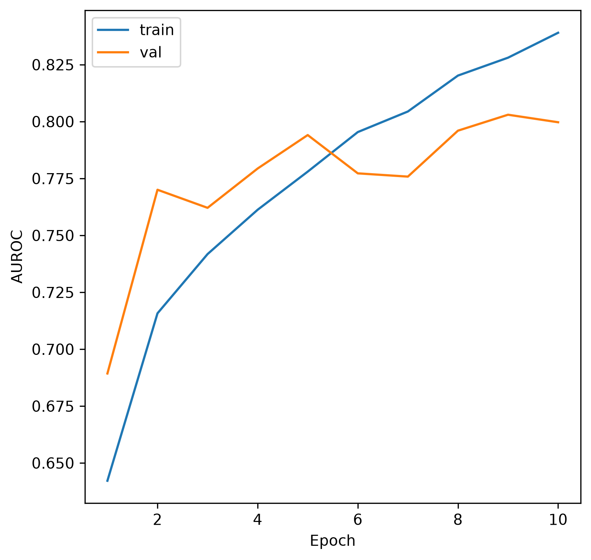
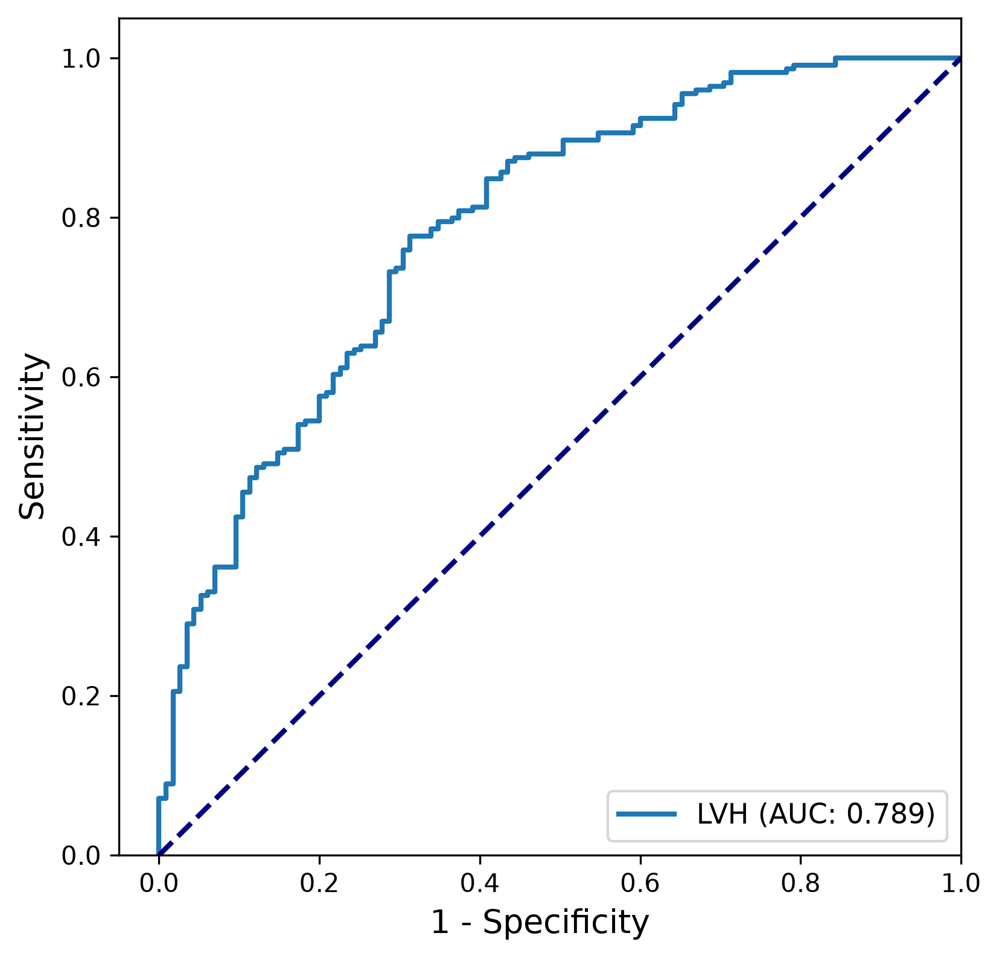

## Introduction

This post is a code-focused deep dive into a deep learning model for the detection of severe aortic stenosis (AS) from echocardiogram videos. The original paper, [Severe aortic stenosis detection by deep learning applied to echocardiography](https://academic.oup.com/eurheartj/article/44/43/4592/7248551), reports a deep learning model that consists of a self-supervised learning (SSL) model architecture used for pretraining and a model fine-tuned for the downstream task of AS classification. 

{fig-align="center"}

In the rest of this post, we will go through the source code of the Self-Supervised Learning (SSL) model architecture and the training loop. Then, using a real world dataset, [EchoNet-LVH](https://echonet.github.io/lvh/), we will demonstrate how to apply the same model architecture to left ventricular hypertrophy (LVH) classification.


## Self-Supervised Learning (SSL) Pretraining

### SimCLR class

SimCLR is a self-supervised learning (SSL) model that contains a 18 layer Resnet3D (3D ResNet-18) backbone as its encoder.

In the initialization:

- **Encoder (`self.encoder`):** The last fully connected layer of the encoder is swapped out for an identity layer (`torch.nn.Identity()`), so the encoder just outputs the features without any final projection. As a result, the encoder maps each video clip to a 512-dimensional feature vector.
- **Reordering head (`self.reordering_head`):** Projects the `n_features` into 24 features, one for each of the 24 possible permutations of the 4 input video frames.
  - It is used for the frame re-ordering "pretext" task, where frames are randomly permuted and the model is trained to predict the correct order of the frames.
- **Projection MLP (`self.projector`):** Projects the `n_features` into a lower-dimensional space for contrastive learning. It consists of:
  - Linear layer
  - ReLU activation
  - Linear layer that outputs the final projected features (`projection_dim`)

```{python}
class SimCLR(torch.nn.Module):
    def __init__(self, encoder, projection_dim, n_features):
        super(SimCLR, self).__init__()

        self.encoder = encoder
        self.n_features = n_features

        # Replace the fc layer with an Identity function
        self.encoder.fc = torch.nn.Identity()

        # Classification head for frame re-ordering classification (after permuting video frames, predict original order)
        self.reordering_head = torch.nn.Linear(self.n_features, 24)

        # We use a MLP with one hidden layer to obtain z_i = g(h_i) = W(2)σ(W(1)h_i) where σ is a ReLU non-linearity.
        self.projector = torch.nn.Sequential(
            torch.nn.Linear(self.n_features, self.n_features // 2, bias=False),
            torch.nn.ReLU(),
            torch.nn.Linear(self.n_features // 2, projection_dim, bias=False),
        )
```

In the forward pass, the method takes two video clips from the same study (patient) as input: `x_i` and `x_j`. Each clip is passed through the encoder to obtain feature representations (`h_i` and `h_j`). The reordering head predicts the order of the frames for each clip (`t_i` and `t_j`),  and the projection MLP projects the features into a lower-dimensional space (`z_i` and `z_j`). The model returns the feature representations, the projected features, and the predicted order of frames for both clips. 

```{python}
def forward(self, x_i, x_j):
    h_i = self.encoder(x_i)
    h_j = self.encoder(x_j)

    t_i = self.reordering_head(h_i)
    t_j = self.reordering_head(h_j)

    z_i = self.projector(h_i)
    z_j = self.projector(h_j)

    return h_i, h_j, z_i, z_j, t_i, t_j
```


### Training Loop

The training starts off with loading the dataset using the `EchoDataset` class. It is initialized with the data directory, the split for training, the clip length, and the sampling rate. A `DataLoader` is then created to load the training dataset in batches, with shuffling enabled and a specified number of worker threads for parallel data loading. The `drop_last=True` argument ensures that any incomplete batch at the end of an epoch is dropped.


```{python}
train_dataset = EchoDataset(
    data_dir=args.data_dir,
    split="100122_train_2016-2020",
    clip_len=args.clip_len,
    sampling_rate=args.sampling_rate,
)
train_loader = torch.utils.data.DataLoader(
    train_dataset,
    batch_size=args.n_gpu * args.batch_size,
    shuffle=True,
    num_workers=12,
    worker_init_fn=seed_worker,
    drop_last=True,
)
```

Then, the encoder is initialized using a 3D ResNet-18 model from the `torchvision` library. The `SimCLR` model is then instantiated with the encoder, the projection dimension, and the number of features from the encoder's fully connected layer.

```{python}
encoder = torchvision.models.video.r3d_18(pretrained=False)
model = SimCLR(
    encoder=encoder,
    projection_dim=args.projection_dim,
    n_features=encoder.fc.in_features,
)
```


Before the training loop, the optimizer is set up using the Adam optimization algorithm with a specified learning rate. The loss functions are also defined: `NT_Xent` for contrastive learning and `CrossEntropyLoss` for the frame reordering classification task. 


```{python}
optimizer = torch.optim.Adam(model.parameters(), lr=args.lr)

loss_fxn = NT_Xent(args.batch_size, args.temperature, world_size=args.n_gpu)
cls_loss_fxn = torch.nn.CrossEntropyLoss()
```


The training loop takes two different echo views of the same patient, `x_i` and `x_j`, and passes them through the model (`model.forward(x_i, x_j)`) to obtain the feature representations, projected features, and predicted frame orders. The contrastive loss (`loss_fxn`) is computed using the projected features, and the classification loss (`cls_loss_fxn`) is computed using the predicted frame orders and the true frame orders. The total loss is the sum of these two losses. 

The backward pass then computes the gradients of the loss with respect to the model parameters, and the optimizer updates the model parameters accordingly. The running loss is accumulated and displayed in a progress bar. 

Finally, the model checkpoint is saved every `save_freq` epochs. The model weights and optimizer state are saved to a file for later use.


```{python}
for epoch in range(1, args.num_epochs + 1):
    running_loss = 0.0
    pbar = tqdm.tqdm(
        enumerate(train_loader), total=len(train_loader), desc=f"Epoch {epoch}"
    )

    for i, batch in pbar:
        x_i, x_j, t_i, t_j = batch
        x_i = x_i.to(device)
        x_j = x_j.to(device)
        t_i = t_i.to(device)
        t_j = t_j.to(device)

        h_i, h_j, z_i, z_j, t_hat_i, t_hat_j = model.forward(x_i, x_j)

        loss = loss_fxn(z_i, z_j) + cls_loss_fxn(
            torch.cat([t_hat_i, t_hat_j]), torch.cat([t_i, t_j])
        )

        # Backward pass
        optimizer.zero_grad(set_to_none=True)
        loss.backward()
        optimizer.step()

        running_loss += loss.item()

        pbar.set_postfix({"loss": running_loss / (i + 1)})

    current_metrics = pd.DataFrame({"epoch": [epoch], "loss": [running_loss / (i + 1)]})
    current_metrics.to_csv(
        os.path.join(model_dir, "history.csv"), mode="a", header=False, index=False
    )

    if epoch % args.save_freq == 0:
        torch.save(
            {
                "weights": model.module.state_dict()
                if isinstance(model, torch.nn.DataParallel)
                else model.state_dict(),
                "optimizer": optimizer.state_dict(),
            },
            os.path.join(model_dir, f"chkpt_epoch-{epoch}.pt"),
        )
```


## Demo with EchoNet-LVH

In the rest of this blog post, we will be using the [EchoNet-LVH dataset](https://echonet.github.io/lvh/) to apply the self-supervised learning (SSL) model architecture for pretraining. Also, we will be finetuning the same model architecture to classify left ventricular hypertrophy (LVH) from echocardiogram videos. This two-step approach of SSL pretraining and finetuning on the SSL initialized model, using the learned weights of the encoder, follows the approach used in the original Echo Severe AS paper.

**Background:** The EchoNet-LVH dataset contains 12,000 PLAX echocardiogram videos of patients who underwent imaging as part of routine clinical care at Stanford Medicine. For each video, EchoNet-LVH provides a table of measurements, including IVSd and LVPWd, which are used to determine the presence of LVH. For the purposes of this demo, we classify LVH as present in each video if the values of IVSd or LVPWd are at least 1.1 cm, following the ASE/EACVI 2015 chamber quantification guidelines. The 2015 ASE/EACVI guidelines state that the upper reference limit for both the interventricular septum at end-diastole (IVSd) and the left ventricular posterior wall thickness at end-diastole (LVPWd) is 1.0 cm (10 mm) for women and men.

**How a pair is made:** EchoNet-LVH has exactly one video per patient, so the original paper's approach of "two different videos from the same study" does not apply to this dataset. The new `EchoNetLVHDataset` class (subclass of `EchoNetDataset`) builds each pair from one `.avi`:

1. It takes two short clips from the video, each starting at its own random frame. The argument `same_clip` allows you to specify whether both views should use the same frames.
2. It shrinks each frame to 112×112 (`frame_size`). The raw 1024×768 frames are too big to train on.
3. It applies edits to each view separately: a shift of up to 8px, a random horizontal flip, a rotation of up to ±10°, and the frame-shuffle label.
4. The resulting pairs are used for training the SSL model.

```{python}
class EchoNetLVHDataset(EchoDataset):
    """
    Variant of EchoDataset for EchoNet-LVH, which has exactly one video per patient. Instead of pairing two different videos from the same study,
    each positive pair is formed from the *same* video: two clips are subsampled (from independent random start frames by default), resized,
    and independently augmented with the same light spatial augmentation + frame re-ordering as EchoDataset.

    Attributes
    ----------
    split: str
        Data split used to select videos (one of ["train", "val", "test"], matching the "split" column of MeasurementsList.csv)
    clip_len : int
        Number of frames to form video clips for training (clip length)
    sampling_rate : int
        Temporal "stride" when sampling frames to form clips
    frame_size : int
        Side length (pixels) that each frame is resized to
    same_clip : bool
        If True, both views use the same clip and differ only by augmentation; otherwise each view samples its own clip
    fnames : list[str]
        List of full paths to videos found on disk for this split
    temporal_orderings : list[tuple]
        List of all permutations of frame indices (target classes for frame re-ordering task)
    """

    def __init__(
        self,
        data_dir,
        split="train",
        clip_len=4,
        sampling_rate=1,
        frame_size=112,
        same_clip=False,
        n=None,
    ):
        self.split = split
        self.clip_len = clip_len
        self.sampling_rate = sampling_rate
        self.frame_size = frame_size
        self.same_clip = same_clip

        label_df = pd.read_csv(os.path.join(data_dir, "MeasurementsList.csv"))
        names = np.sort(
            label_df.loc[label_df["split"] == self.split, "HashedFileName"].unique()
        )

        batch_dirs = sorted(
            d
            for d in os.listdir(data_dir)
            if d.startswith("Batch") and os.path.isdir(os.path.join(data_dir, d))
        )
        available = {}
        for batch_dir in batch_dirs:
            for fname in os.listdir(os.path.join(data_dir, batch_dir)):
                if fname.endswith(".avi"):
                    available.setdefault(
                        fname[:-4], os.path.join(data_dir, batch_dir, fname)
                    )

        self.fnames = [available[name] for name in names if name in available]
        print(
            f"{self.split}: found {len(self.fnames)} of {len(names)} videos ({len(names) - len(self.fnames)} missing on disk)"
        )

        if n is not None:
            self.fnames = self.fnames[:n]

        self.temporal_orderings = [
            _ for _ in itertools.permutations(np.arange(self.clip_len))
        ]

    def _resize(self, x):
        return np.stack(
            [
                cv2.resize(
                    frame,
                    (self.frame_size, self.frame_size),
                    interpolation=cv2.INTER_AREA,
                )
                for frame in x
            ],
            axis=0,
        )

    @staticmethod
    def _normalize(x):
        x = x.astype(np.float32)
        return (x - x.min()) / max(x.max() - x.min(), 1e-8)

    def __len__(self):
        return len(self.fnames)

    def __getitem__(self, idx):
        x = load_video(self.fnames[idx])

        # Sample two clips from the same video (same clip if same_clip=True)
        x_i = self._resize(self._sample_frames(x))
        x_j = x_i.copy() if self.same_clip else self._resize(self._sample_frames(x))

        # Independently augment each view and obtain frame ordering label
        x_i, reordering_i = self._augment(x_i)
        x_j, reordering_j = self._augment(x_j)

        # Min-max normalize and swap axes for PyTorch
        x_i = np.transpose(self._normalize(x_i), (3, 0, 1, 2))
        x_j = np.transpose(self._normalize(x_j), (3, 0, 1, 2))

        return (
            torch.from_numpy(x_i).float(),
            torch.from_numpy(x_j).float(),
            torch.tensor(reordering_i).long(),
            torch.tensor(reordering_j).long(),
        )
```


### SSL Pretraining

The training step is performed on the EchoNet-LVH dataset and is identical to the training loop described in the previous section. It was trained on 1 NVIDIA RTX 4090 GPU from [Runpod](https://www.runpod.io/) for 120 epochs. 

Below is a graph of the number of epochs versus the training loss. The training loss decreases over time, indicating that the model is learning. Future work could include increasing the number of epochs to improve the model's performance.





### LVH FineTuning

Then, using the learned encoder weights from the SSL pretraining step, we fine-tune the same model architecture (3D ResNet-18) for the downstream task of LVH classification. First, we initialize the model weights with the learned encoder weights from the SSL pretraining step. Then, we replace the last fully connected layer of the model with a new linear layer that outputs a single value for binary classification (LVH present or not). 


```{python}
# Create model
if model_name == "3dresnet18":
    weights = torchvision.models.video.R3D_18_Weights.DEFAULT if not rand_init else None
    model = torchvision.models.video.r3d_18(weights=weights)

    if dropout_fc:
        model.fc = torch.nn.Sequential(  # type: ignore
            torch.nn.Linear(512, 1), torch.nn.Dropout(0.25)
        )

        if lpft != "":
            # Linear probing fine-tuning (LPFT) weights are stored in a dict under the key "weights"
            weights = dict(torch.load(lpft, map_location="cpu")["weights"])

            model.fc[0].weight.data = weights["fc.0.weight"]
            model.fc[0].bias.data = weights["fc.0.bias"]

    else:
        model.fc = torch.nn.Linear(512, 1)
        if lpft != "":
            # Linear probing fine-tuning (LPFT) weights are stored in a dict under the key "weights"
            weights = dict(torch.load(lpft, map_location="cpu")["weights"])

            model.fc.weight.data = weights["fc.weight"]
            model.fc.bias.data = weights["fc.bias"]

    if ssl != "":
        checkpoints = [f for f in os.listdir(ssl) if f.endswith(".pt")]
        idx = np.argmax([int(f.split(".")[0].split("-")[1]) for f in checkpoints])
        weights = torch.load(os.path.join(ssl, checkpoints[idx]), map_location="cpu")[
            "weights"
        ]
        weights = {
            k.replace("encoder.", ""): v for k, v in weights.items() if "encoder" in k
        }

        model.load_state_dict(weights, strict=False)
```

Then, for a maximum of 10 epochs, we train the model on the training set of the EchoNet-LVH dataset using the Adam optimization algorithm with a specified learning rate. The binary cross-entropy loss function is used to compute the loss between the predicted and true labels. The model is evaluated on the validation set after each epoch, and the best model with the lowest validation loss is saved for later use.

```{python}
while epoch <= max_epochs and early_stopping_dict["epochs_no_improve"] < patience:
    history = train(
        model=model,
        device=device,
        loss_fxn=loss_fxn,
        optimizer=optimizer,
        data_loader=train_loader,
        history=history,
        epoch=epoch,
        model_dir=model_dir,
    )
    history, early_stopping_dict, best_model_wts = validate(
        model=model,
        device=device,
        loss_fxn=eval_loss_fxn,
        optimizer=optimizer,
        data_loader=val_loader,
        history=history,
        epoch=epoch,
        model_dir=model_dir,
        early_stopping_dict=early_stopping_dict,
        best_model_wts=best_model_wts,
    )

    epoch += 1
```

In the line plot below, we see the training loss and validation loss decrease over time, indicating that the model is learning. 

{height=392px}

Also, we see the AUROC for both the training and validation sets increase over time, indicating that the model is improving its ability to distinguish between the two classes (LVH present or not). The model weights are only saved when the validation AUROC improves, so the best model is the one with the highest validation AUROC.

{height=392px}

Finally, below is the test-set ROC curve, which shows an AUC of 0.789. 

{height=392px}


## Conclusion

In this post, we have gone through the source code of the Self-Supervised Learning (SSL) model architecture and the training loop. Then, using a real world dataset unrelated to the original paper, EchoNet-LVH, we demonstrated how to apply the same model architecture to left ventricular hypertrophy (LVH) classification. When fine-tuning the model for LVH classification, we achieved a test-set AUC of 0.789 and training and validation loss decrease over time. Future work could include increasing the number of epochs to improve the model's performance.